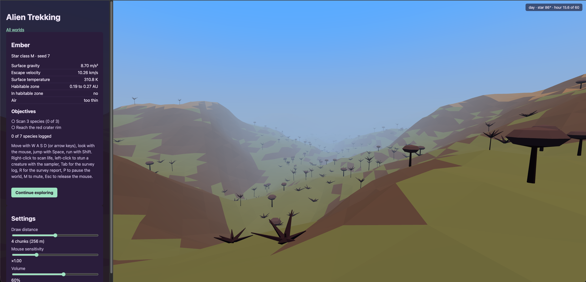
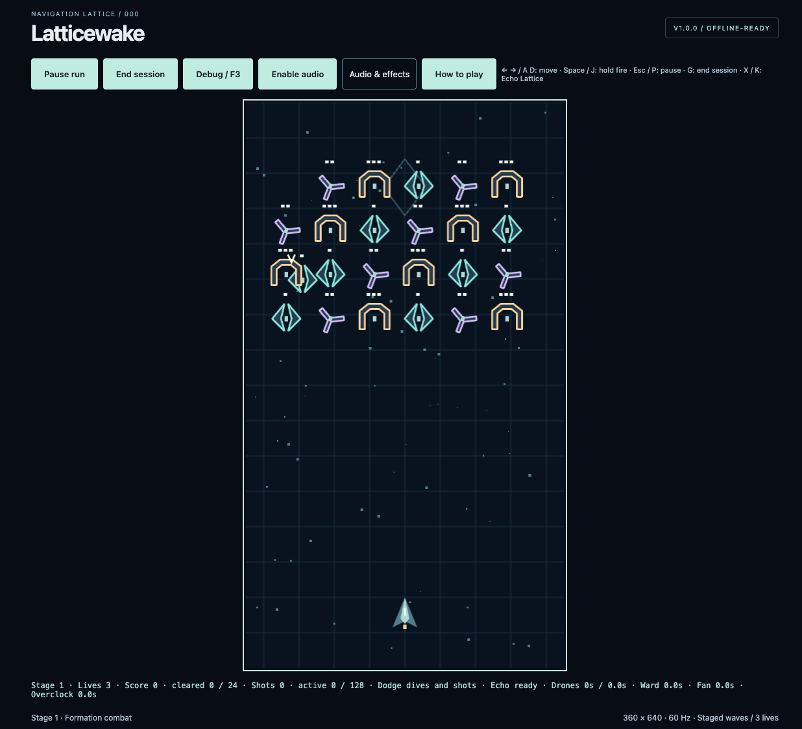
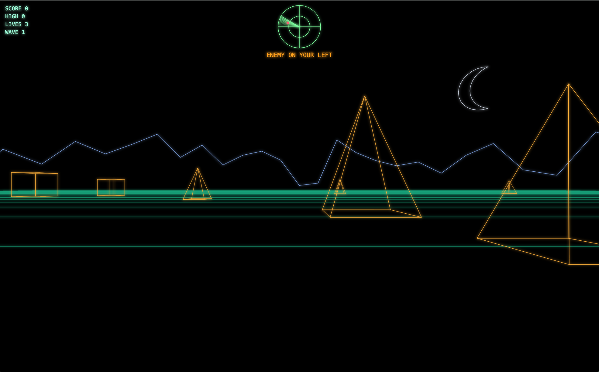
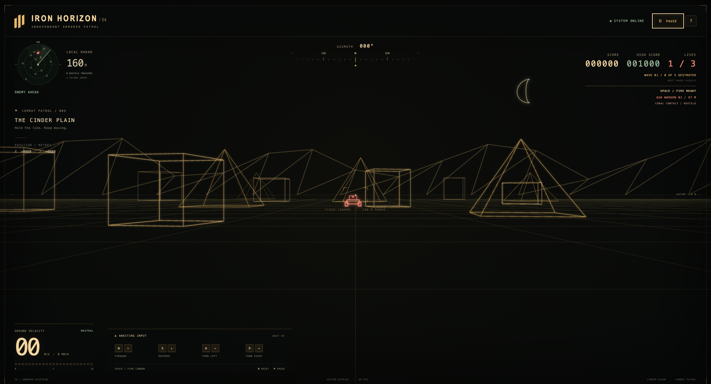
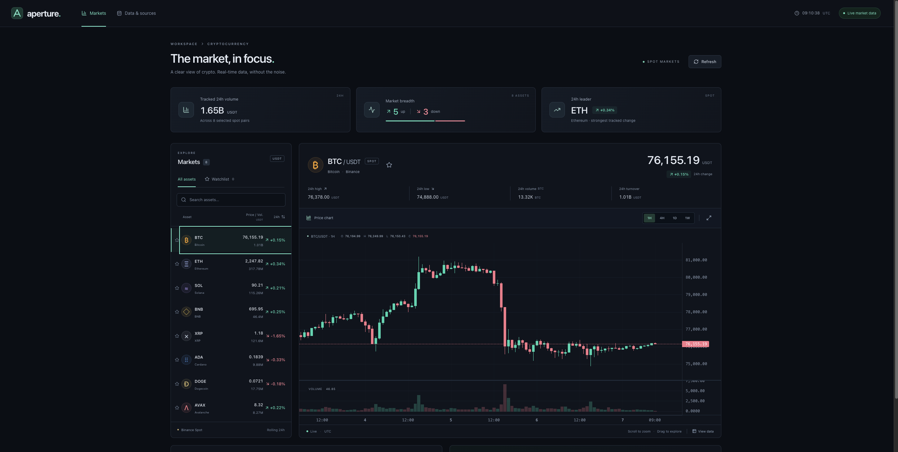
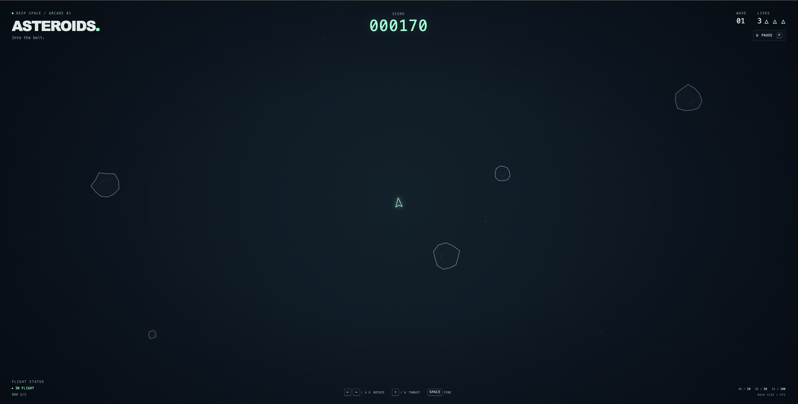
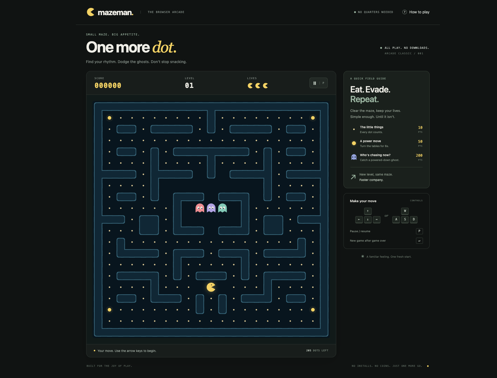

# Built with Certo

**Seven projects, from a single text file each, built by AI coding agents and checked by [Certo](https://github.com/alessioricco/Certo).**

Every game and app in this repository started as a plain Markdown task in [`tasks/`](tasks/). Certo handed each task to a coding agent, chose the model, kept it inside a time and cost budget, and then re-ran the project's own tests and build before calling it done. What you see below is what came out.

---

## What is Certo?

[Certo](https://github.com/alessioricco/Certo) is a **coding-agent harness**: the layer around the model that runs the agent, gives it its tools, chooses the model, sets the limits and checks the result. *The model writes the code; the harness decides what counts as done.* (*Certo* is Italian for "sure".)

- **It doesn't take the agent's word for it.** When the agent says it's finished, Certo runs the real tests and build itself, with no AI involved, and ends with one verdict (`verified`, `failed`, `budget_exhausted`, …) and an exit code a script can rely on.
- **Any model, local or cloud.** Ollama, Anthropic, OpenAI, Gemini, DeepSeek or any LiteLLM model. Switching provider is one setting.
- **The right model for each task.** `--auto-model` picks the cheapest model that fits the task; `--escalate` climbs a ladder you write (for example local → Haiku → Sonnet). Either way, a stronger model steps in only when verification shows the previous one couldn't finish, or its provider goes down.
- **Big projects, one milestone at a time.** `--milestones` runs each `## Milestone N` of a task file in its own conversation and verifies it before starting the next. `--resume` continues where a run stopped.
- **Everything is written down.** `MODEL_DECISIONS.md` records why each model was picked; `.certo/RUNS.md` records every run's model, time, tokens and cost.

```bash
uv tool install certo        # or: pip install certo
certo init                   # pick Ollama for a local model, or a cloud provider
cd certo-workspace && certo tasks/wordle.md --project wordle
```

[Documentation](https://github.com/alessioricco/certo/blob/main/docs/README.md) · [Getting started](https://github.com/alessioricco/certo/blob/main/docs/getting-started.md) · [Escalate between models](https://github.com/alessioricco/certo/blob/main/docs/guides/escalate-between-models.md)

---

## Models that hand off to each other

Most of these projects weren't built by one model. Certo starts on a fast, cheap model and, when its checks show the work isn't finished, passes the task to another model, from another provider if needed, with a note on where things stand. The cheap model does the bulk of the work, and stronger models step in only for the parts that need them. This is how Certo is meant to be used: you get the strengths of several models without paying frontier prices for every step.

| Project | Models that worked on it |
| --- | --- |
| Alien Trekking | Claude Haiku 5.5 → GPT-6.1 Terra → Claude Sonnet 5.5 |
| Latticewake | Gemma 4, Qwen3 Coder, Devstral (local) · Claude Haiku 5.5 · GPT-6 Luna · GPT-6.1 Sol |
| Iron Horizon | Claude Haiku 5.5 *and*, as a separate run, GPT-6.1 Sol |
| Aperture Markets, Asteroids, Mazeman | GPT-6.1 Sol |

## The showcase

### 🪐 Alien Trekking



Land on an alien planet and survey it on foot. Each world is a small JSON file describing its star, mass, orbit and seed; the engine works out gravity, temperature, habitability and air from the physics, and generates the terrain from the seed. Scan species, avoid predators, complete objectives and make it back to the lander. TypeScript, Vite and Three.js.

**How it was built:** three models from two providers, working as a team. Over 7 milestones on `--auto-model`, Claude Haiku 5.5 opened every milestone and did most of the work cheaply. When Certo's checks caught a problem, it handed the fix to GPT-6.1 Terra, which happened on 4 milestones. On the hardest milestone it also brought in Claude Sonnet 5.5. Nobody picked a model by hand. **9 runs, under 2 hours of agent time, $7.83.**

[Task](tasks/alien-trekking.md) · [Project](projects/alien-trekking/) · [Model decisions](projects/alien-trekking/MODEL_DECISIONS.md)

### 🛸 Latticewake



An original fixed shooter, built as a full 1.0 release across 9 milestones: formations, attack waves, power-ups, a boss, optional audio, accessibility, local scores, touch and gamepad support, and an offline-capable PWA build. TypeScript and Vite with native Canvas and WebAudio, tested with Vitest and Playwright across three browser engines.

**How it was built:** a real relay of models, local and cloud. Local models running on the machine (Gemma 4, Qwen3 Coder, Devstral) took turns alongside Claude Haiku 5.5, GPT-6 Luna and GPT-6.1 Sol, and Certo moved the work between them milestone by milestone. Every switch is recorded in [`MODEL_DECISIONS.md`](projects/latticewake/MODEL_DECISIONS.md).

[Task](tasks/latticewake-m1-m9.md) · [Project](projects/latticewake/)

### 🛡️ Iron Horizon: one task, two models

<table>
<tr>
<td width="50%"></td>
<td width="50%"></td>
</tr>
<tr>
<td><b>Claude Haiku 5.5</b><br>4 milestones · 14 min · <b>$0.34</b></td>
<td><b>GPT-6.1 Sol</b><br>4 milestones · 28 min · <b>$3.31</b></td>
</tr>
</table>

A first-person wireframe tank game with a hand-written 3D renderer on a plain 2D canvas: no libraries, no build. The **same task file**, run twice with only the model changed. Both runs ended `verified` on every milestone. Haiku delivered the classic vector look for a tenth of the cost; Sol spent more and came back with a full cockpit HUD. Same harness, same checks — you pick the trade-off.

[Task](tasks/iron-horizon.md) · [Haiku version](projects/iron-horizon/) · [Sol version](projects/iron-horizon-sol/)

### 📈 Aperture Markets



A cryptocurrency market-data dashboard on live public Binance data: market overview, watchlist and candlestick charts. A viewer only, with no trading, wallets or keys, and errors shown honestly rather than hidden behind fake prices. React, TypeScript, Tailwind, TanStack Query and Lightweight Charts, with Playwright end-to-end tests.

**How it was built:** GPT-6.1 Sol.

[Task](tasks/crypto-dashboard.md) · [Project](projects/crypto-dashboard/)

### ☄️ Asteroids: Into the Belt



A vector-style space-rocks arcade game in plain JavaScript, HTML and CSS, with endless waves and touch controls. No dependencies: open `index.html` and play.

**How it was built:** GPT-6.1 Sol, from one of the sample tasks that ship with `certo init`.

[Task](tasks/space-rocks.md) · [Project](projects/asteroids/)

### 🟡 Mazeman



A maze chase with ghosts and power pellets, in plain browser JavaScript with no packages or build step.

**How it was built:** GPT-6.1 Sol in a single run: 8 minutes, $0.62, `verified`.

[Task](tasks/mazeman.md) · [Project](projects/mazeman/)

---

## Run them

Each project has its own README with full instructions. In short:

| Project | How to run |
| --- | --- |
| Asteroids, Mazeman, Iron Horizon (both) | Open the project's `index.html` in a browser. Nothing to install. |
| Alien Trekking | `cd projects/alien-trekking && npm ci && npm run dev` (Node 18+) |
| Latticewake | `cd projects/latticewake && npm ci && npm run dev` (Node 22.22) |
| Aperture Markets | `cd projects/crypto-dashboard && npm ci && npm run dev` (Node 22.22+) |

## Build your own

A task is just a text file saying what to build. Open any file in [`tasks/`](tasks/) to see how these were written, then write your own:

```bash
certo check                                       # confirm your model settings work
certo tasks/my-game.md --project my-game          # one run
certo tasks/my-game.md --project my-game --milestones --auto-model   # milestone by milestone, model picked per task
```

The last line Certo prints is the verdict. `Verification: verified` means Certo re-ran the project's own tests itself, after the agent said it was done, and they passed. `certo verify path/to/repo` runs the same checks with no agent and no model, so it costs nothing.

A few things worth knowing:

- **The model matters.** The same task can come out quite differently on different models (see Iron Horizon above). The verdict says whether the tests passed, not how polished the result is.
- **Cost.** Cloud models use your credits. Certo prints the tokens and cost at the end of every run, and `CERTO_MAX_TASK_COST` caps it.
- **Local models.** With Ollama, give the server a larger context window, for example `OLLAMA_CONTEXT_LENGTH=32768 ollama serve`; the default 4096 tokens is too short for an agent.

## Repository layout

```
tasks/       the task files, one per project
projects/    what Certo built, one folder per project, each with its own README
```

Model names, times and costs above come from each project's `MODEL_DECISIONS.md` and Certo run records.

**Like what you see? [Try Certo](https://github.com/alessioricco/Certo).**
