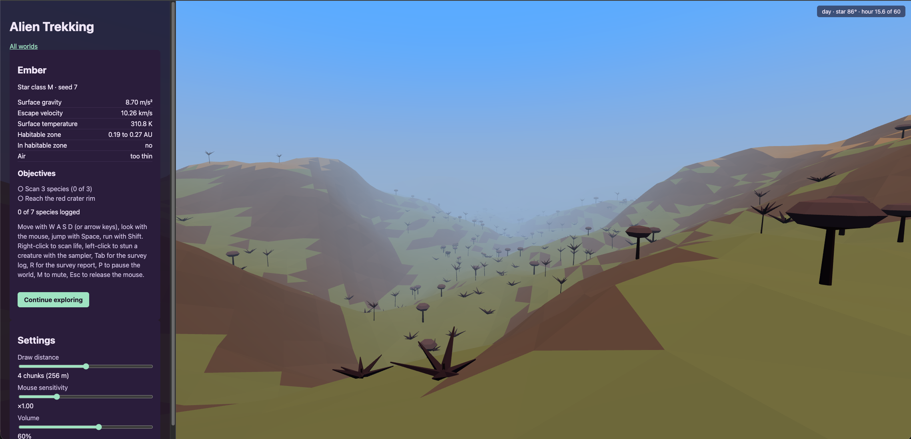

# Alien Trekking

An exploration game on alien worlds, in the browser. You land on a planet and
survey it on foot under an alien sun. Worlds are data: each one is a small JSON
file in `levels/`. The engine computes gravity, temperature, habitability and
air from the planet's physical description, and generates the terrain from its
seed, so every world looks different.



Requires Node.js 18 or newer (`node -v`).

## Install

From the project folder:

```bash
npm ci
```

`npm ci` installs exactly the versions in `package-lock.json`. Dependencies go
into `node_modules/`; no virtual environment is involved.

## Run

Start the development server:

```bash
npm run dev
```

Open http://localhost:5173/. The title screen lists the worlds from
`levels/index.json`, shows the progress you have made in each, and has a field
for a world's URL. Choose a world, or open
http://localhost:5173/?level=verdant-g directly. The left panel shows the
world's facts, its objectives and a **Start exploring** button. Click it to
capture the mouse and walk the terrain. Press Esc to release the mouse and show
the panel again.

The sky runs in real time: an hour of world time takes 10 seconds, so a 24-hour
day passes in four minutes (a 60-hour day in ten). The clock in the top right
shows the phase (dawn, day, dusk or night), the star's height above the horizon,
and the hour since sunrise. The game starts mid-morning. To start at another
hour, add `hour`, in world hours since sunrise (0 is sunrise):

- http://localhost:5173/?level=verdant-g&hour=22 starts at night, under stars
- http://localhost:5173/?level=ember-m&hour=18 starts with Ember's moon in the sky

Other worlds, from the list at the top of the panel or by address:

- http://localhost:5173/?level=ember-m
- http://localhost:5173/?level=boulder-k

A world can also come from a file name in `levels/`, or from a URL:

- http://localhost:5173/?level=ember-m.json
- http://localhost:5173/?level=https://example.com/worlds/my-world.json

An invalid level shows its errors on the page instead of a world. The format of
a world, every field and its range, and how to publish one at a URL are in
[LEVELS.md](LEVELS.md).

To build and serve the production bundle:

```bash
npm run build
npm run preview
```

`npm run build` type checks the code, then writes the site to `dist/`, with the
worlds copied to `dist/levels/`.

## Objectives, the survey report and assets

Each world has objectives, listed in the panel before you start and at the top
left during play with a tick when each is done:

- **Scan species.** Log a number of species (up to seven) with right-click.
- **Reach a landmark.** A rock feature the world generates from its seed: a
  spire, an arch or a pillar, 120 to 300 m from the lander. Walk within 12 m of it.
- **Return to the lander.** Go more than 60 m away, then come back to the lander.

When every objective is done, the survey report opens: the planet's facts, the
objectives and the species you logged. Press R to open or close it at any time.

Your progress is saved in the browser (`localStorage`), per world: the species
logged, the landmarks reached and the trek back. It is kept across reloads.
Clearing the site's data resets it.

A world can give the lander or any named species a glTF model (`.glb` or
`.gltf`), a texture, or both. A texture without a model is applied to generated
geometry. If an asset cannot be loaded, the generated version is used, and the
briefing and the objectives panel say so.

## Controls

| Input | Action |
| --- | --- |
| Mouse | Look around (after clicking **Start exploring**) |
| W A S D, or arrow keys | Walk forward, left, back, right |
| Space | Jump |
| Shift | Run |
| Right mouse button | Scan the plant or animal at the crosshair (within 40 m) |
| Left mouse button | Sampler: stun the animal or predator at the crosshair for 5 s (8 s recharge) |
| Tab | Open or close the survey log |
| R | Open or close the survey report (once the objectives are done, it opens by itself) |
| P | Pause or resume the world, including survival and sound |
| M | Mute or unmute sound |
| Esc | Release the mouse and pause; click **Continue exploring** to resume |

Walking is 4 m/s and running 8 m/s. You cannot climb slopes steeper than 45°,
but you can walk down them. Gravity sets the jump: about 0.50 m on Verdant
(9.81 m/s²), about 0.22 m on Boulder (21.8 m/s²). The ground is generated from
the level's `seed`, so the same file always gives the same land.

Each world has three plant and two animal species with generated names and
shapes. Plant colours follow the star; grass-like lowlands support more plants,
while steep, high or very cold/hot terrain supports fewer or none. Grazing
herds wander and flee when approached at a run or startled at close range.
Aim at life until the scan hint appears, then right-click to identify it. Each
species appears only once in the Tab survey log, and the log is saved per world
in the browser. Very hostile temperatures may leave a world without visible life.

Footsteps and head bob follow the world's gravity. Browser-generated sound includes
wind (stronger in thicker air), animal calls and scanner sounds. Audio starts when
you click **Start exploring**. M mutes it until pressed again.

## Settings and performance

The settings panel is on the world list and the briefing; press Esc during play to
open the briefing. Changes are saved immediately in browser `localStorage` under
`alien-trekking:settings` and apply across worlds and reloads:

| Setting | Range | Default |
| --- | --- | --- |
| Draw distance | 2–6 chunks (64 m per chunk) | 4 chunks |
| Mouse sensitivity | 0.25–3 times the base speed | 1 |
| Volume | 0–100% | 60% |

Lower draw distance to reduce terrain work. Nearby terrain uses the full grid;
distant chunks use a simpler mesh without plants or animals. Terrain and life
are generated over multiple frames, and off-screen objects are culled. The game
targets 60 fps, but actual performance depends on the device, graphics settings
and custom assets; a timing test does not guarantee a frame rate.

## Survival and predators

The HUD at the bottom left shows your health, oxygen, the outside temperature
and the sampler's recharge. You land at the lander (the craft at the start).

- **Oxygen.** On breathable air (Verdant, Boulder) the suit needs no oxygen. On
  thin or toxic air (Ember) the tank drains 0.1% per second while walking, 0.3%
  per second while running, and refills at 25% per second at the lander. An
  empty tank costs 2 health per second.
- **Temperature.** Outside 0 °C to 40 °C (273.15 K to 313.15 K), health falls
  0.1 per second for each kelvin beyond that band. Boulder, at 319 K, costs
  about 0.6 health per second. The lander shelters you from the outside air.
- **Health.** Starts at 100. The lander restores 4 per second. At zero health
  you wake at the lander with full health and oxygen; the survey log is kept.
- **Predators.** Each world has two predator species. A predator guards a
  territory of 16 m around its den, marked on the ground by bones and claw
  scratches. Entering it, you hear a call and see it raise its head: the warning.
  If you stay for 4 s, it charges and strikes for 20 health every 1.5 s while
  you are within 2 m. Leaving the territory ends the chase. On Verdant a
  running player (8 m/s) outruns a charge (about 7.5 m/s).
- **Sampler.** Aim at an animal or predator and press the left mouse button to
  stun it for 5 s. The sampler then recharges for 8 s. A stun never harms the
  creature.

Herds and predators are regenerated when their chunk loads again, so a
predator you stunned and left is back in its den once its chunk has unloaded.

## Tests, type check and lint

```bash
npm test          # unit tests (Vitest), run once
npm run typecheck # TypeScript, no emit
npm run lint      # ESLint, fails on any warning
```

The tests cover physics, terrain, chunk planning, the player, levels and their
loading, the sky, species generation, habitat, herds, scanning, survival
(oxygen, temperature, health, the lander), the sampler's cooldown and stun,
and predators (territory, warning, attack, patrol, placement), and the objectives,
saved progress, landmarks, survey report and assets (validation, fallback and
model fitting). Renderer tests also check the star field, life meshes, their
placement on terrain, the landmarks, asset loader, distance detail and view
culling. A timing test measures chunk and plant generation; visual rendering and
sound can be checked by running the game in a browser.

## Adding a world

A world is a JSON file, so adding one needs no code change. The full reference,
with every field and its range, is in [LEVELS.md](LEVELS.md).

1. Create `levels/<name>.json` following the format below.
2. Add `{ "id": "<id>", "file": "<name>.json" }` to `levels/index.json`.

Format (units: Earth masses and radii, solar luminosity classes, AU, hours, atm):

```json
{
  "id": "verdant-g",
  "name": "Verdant",
  "seed": 42,
  "star": { "class": "G" },
  "planet": {
    "massEarths": 1.0,
    "radiusEarths": 1.0,
    "orbitAU": 1.0,
    "albedo": 0.3,
    "dayLengthHours": 24,
    "atmosphere": { "pressureAtm": 1.0, "oxygenFraction": 0.21 }
  },
  "objectives": [
    { "kind": "scan-species", "count": 5 },
    { "kind": "reach-landmark", "name": "the tall spire" }
  ],
  "assets": {}
}
```

Star classes: `M`, `K`, `G`, `F`, `A`. Allowed ranges: mass 0.1 to 10, radius 0.3
to 3, pressure 0 to 10 atm, oxygen fraction 0 to 1. The `seed` shapes the
terrain: change it to get a different landscape with the same planet.

## Project layout

- `src/engine/`: physics, terrain, chunk planning, the player, levels and
  their loading, the sky (colours, star altitude, fog, day phases), stars and
  moons, species, habitats, herds, predators, the survey, the sampler, the
  lander and survival (oxygen, temperature, health), as plain TypeScript.
  Nothing here imports Three.js or touches the DOM.
- `src/render/`: Three.js rendering. `view.ts` has the renderer and camera;
  `sky.ts` the sky dome, sun, stars, moons, fog and lights; `terrain.ts` builds
  and drops the ground chunks, `life.ts` streams plants, animals and predators,
  and `lander.ts` builds the landed craft.
- `src/engine/` also holds the objectives, saved progress (`progress.ts`),
  landmarks (`landmarks.ts`), asset references (`assets.ts`) and the survey
  report (`report.ts`).
- `src/render/` also has `landmarks.ts` (the rock features) and `assets.ts`
  (loads glTF models and textures, with the generated fallback).
- `src/main.ts`: the page, the input and the game loop. `pages.ts` builds the
  title screen, the briefing, the error panels and the survey report;
  `objectivesHud.ts` the objectives during play; `progressStore.ts` reads and
  writes the saved progress. `hud.ts` shows the vitals, `sound.ts` plays the
  predator's warning call, and `dom.ts` has small DOM helpers.
- `levels/`: the worlds, plus `levels/index.json`. `LEVELS.md` documents the format.
- `tests/`: Vitest tests; `tests/engine/` for the engine.
- `THIRD_PARTY_NOTICES.md`: the open-source packages used, with licenses.
- `DECISIONS.md`: why the stack and rules are as they are.
- `CHANGELOG.md`: one section per milestone, with how to check it by hand.

---

Generated with [Certo](https://github.com/alessioricco/Certo).

<!-- certo:models -->
*Generated with [Certo](https://github.com/alessioricco/certo), using `anthropic/claude-haiku-5-5`, `openai/gpt-6.1-terra`, `anthropic/claude-sonnet-5-5`.*
<!-- /certo:models -->
