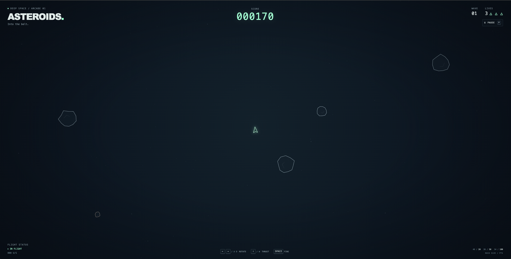

# Asteroids — Into the belt

An offline, vector-style arcade game in plain JavaScript, HTML, and CSS. A little ship, drifting rocks, and an endless run of increasingly crowded waves.

## Preview



## Play

**No dependencies to install. No server, build step, account, or internet connection needed.** Open `index.html` directly in a modern browser (Chrome, Edge, Firefox, or Safari).

From the workspace root:

```sh
cd projects/asteroids
```

Then double-click `index.html`, or run the command for your operating system:

```sh
# macOS
open index.html

# Linux
xdg-open index.html

# Windows Command Prompt
start index.html
```

The game starts immediately. The canvas fills the window and adapts to resizing and high-DPI displays. On touch devices, hold the on-screen rotation, thrust, and fire buttons; multiple controls can be held together.

### Controls

| Action | Keys |
| --- | --- |
| Rotate | Left / Right arrows or A / D |
| Thrust | Up arrow or W |
| Fire | Hold Space |
| Pause / resume | P or the on-screen pause button |
| New game after game over | Enter or **Fly again** |

Friction gradually slows the ship when thrust is released. The ship, bullets, and rocks wrap around every edge. You can have at most **5 bullets** in flight; each lasts **1.15 seconds**.

- A **large** rock earns **20 points** and splits into two medium rocks.
- A **medium** rock earns **50 points** and splits into two small rocks.
- A **small** rock earns **100 points** and disappears.
- Start with **3 lives**. A collision costs one life. A dashed shield gives you **2.4 seconds** of protection at the start and after respawning.
- The first wave has **4 large rocks**. Clear the belt to start a new wave with **one more large rock**.
- Score, lives, and wave remain visible, including while paused and after game over.

Changing tabs or moving focus away from the browser automatically pauses and clears held controls. Press **P** or **Resume flight** when you return. Reduced-motion preferences disable decorative explosions and score floaters; the game itself still moves.

## Run the tests

Tests require **Node.js 18 or newer**, which includes the test runner. There are **no npm packages**, so no install command is needed.

From this directory:

```sh
npm test
```

Or, equivalently:

```sh
node --test
```

The suite covers every supplied helper example, three-life initialization, last-life game over, movement and friction, frame-rate independence, wrapping and edge-seam collisions, bullet limits/expiry, splitting and scoring, spawn protection, waves, pause/resume, restart, resizing, and loading the rules as a classic browser script.

## Files and game logic

- `game.js` — DOM-free rules. Loads through a plain `<script>` or Node's `require`.
- `main.js` — canvas rendering, animation, keyboard and touch input, and HUD updates.
- `index.html`, `style.css` — responsive interface; all assets are local or generated.
- `game.test.js` — Node built-in tests, without mocks or third-party packages.
- `package.json` — the dependency-free test command.

The simulation runs fixed 1/120-second steps from elapsed frame time, so rendering frequency does not alter movement or firing cadence. Collision distances respect the wrapping playfield. Randomness can be supplied to the constructor for reproducible simulations.

```js
const { Game, wrap, splitRock, pointsFor, circlesCollide } = require("./game.js");
const game = new Game(800, 600);
game.update(1 / 60, { thrust: true, shoot: true });
console.log(game.score, game.lives, game.wave);
game.togglePause();
game.resize(1024, 768);
game.restart();
```

`update` takes seconds and an optional object with `left`, `right`, `thrust`, and `shoot` booleans. `drainEvents()` returns and clears visual notifications for destroyed rocks, lost ships, and new waves. All gameplay decisions stay in `game.js`; the renderer does not change the rules.
