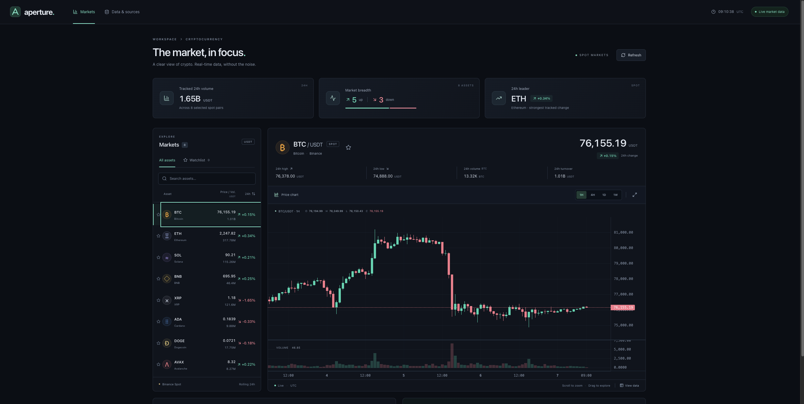

# Aperture Markets

A focused, responsive cryptocurrency market-data dashboard with original branding. React, TypeScript, Vite, Tailwind CSS, TanStack Query, and TradingView Lightweight Charts. This is a **viewer**, not a trading application: no orders, accounts, wallet connections, API keys, or financial advice.

## Preview



## Install and run

Use **Node.js 22.22+** (or a current Node 24+ LTS) and npm. From the repository root:

```bash
cd projects/crypto-dashboard
npm ci
npm run dev
```

Open **http://127.0.0.1:5173**. Vite prints the actual URL if that port is busy. No `.env` or API credentials are needed. An internet connection and access to Binance's public market-data service are required to show prices.

### Production

From `projects/crypto-dashboard`:

```bash
npm run build
npm run preview -- --port 4173 --strictPort
```

Open **http://127.0.0.1:4173**. `build` runs strict TypeScript checks and generates the static site in `dist/`. Deploy **only `dist/`** to your HTTPS static host, not the source directory, environment files, or dependencies. `preview` is a local verification server, not a production server. Browser requests go directly to Binance; there is no server proxy or backend.

## Verification

Run from `projects/crypto-dashboard`:

```bash
npm test
npm run typecheck
npm run build
npx playwright install chromium
npm run test:e2e
npm audit
```

`npm test` runs Vitest once (not watch mode). `npm run test:watch` is available for development. `test:e2e` builds the production app and runs Playwright against its preview server on port 4173. Unit tests cover response validation, chronological candle merging, formatting, freshness, watchlist interaction, and UI states. Browser tests exercise the actual chart library, market/interval selection, watchlist persistence, mobile layout, offline/retry behavior, regional and rate-limit errors, malformed data, and live-data expiry.

Test-only service-boundary fixtures make failures and timing deterministic; **production has no fixture/mock-data fallback**. Only native transport is replaced where controlled disconnects or server errors are necessary; the parsers, reconnect logic, React components, Query cache, and chart library run normally. A real Binance browser smoke test was also performed during development, but live network availability is deliberately not a prerequisite for the repeatable test suite.

Because this repository contains multiple independent projects, point workspace verification at `projects/crypto-dashboard`, not the shared repository root.

## Using the dashboard

- Search eight curated USDT markets: BTC, ETH, SOL, BNB, XRP, ADA, DOGE, and AVAX.
- Select an asset to see its price, rolling 24-hour change, high/low, base volume, and USDT turnover.
- Star assets to create a watchlist. Only these symbol preferences are saved locally; prices are never persisted.
- Use **1H / 4H / 1D / 1W** to change candle intervals. Drag the chart to pan, scroll/pinch to zoom, or use **Fit chart to all data** to reset. The chart initially shows roughly 100 of the latest 300 candles. Older history is not downloaded while panning.
- Volume bars use the selected coin's base units. Market-list volume and tracked volume use **USDT quote volume**, not USD, market cap, or a total-market estimate.
- **View data** provides a keyboard-accessible table of the latest eight candles. Search, favorites, sorting, retry, and interval controls are native keyboard-accessible controls. Positive and negative values include signs/directional indicators, not color alone.
- All timestamps and candle boundaries are **UTC**. The current candle is provisional until its interval closes. The 24-hour range is independent of the selected candle interval.

## Data source and reliability

Uses Binance's documented **public Spot market-data-only** endpoints, with native browser `fetch` and `WebSocket`. No authentication headers, keys, trading API, alternate provider, or region-bypass proxy is used.

- REST base: `https://data-api.binance.vision`
- Current prices and rolling statistics: `GET /api/v3/ticker/24hr?symbols=[...]` (one batched request for the eight curated pairs).
- History: `GET /api/v3/klines?symbol=BTCUSDT&interval=1h&limit=300` (symbol and interval follow selection).
- WebSocket base: `wss://data-stream.binance.vision/stream?streams=...`
- One combined socket subscribes to each curated `<symbol>@ticker` and the selected `<symbol>@kline_<interval>`, using lowercase stream symbols.

[Official public market-data documentation](https://github.com/binance/binance-spot-api-docs/blob/master/faqs/market_data_only.md) · [REST reference](https://developers.binance.com/docs/binance-spot-api-docs/rest-api/market-data-endpoints) · [WebSocket reference](https://developers.binance.com/docs/binance-spot-api-docs/web-socket-streams)

### What the connection labels mean

- **Live market data:** validated selected-symbol ticker **and** candle events have source timestamps within 15 seconds, the socket is receiving data, the browser is online, and usable ticker/history data exists without a current request error.
- **REST snapshot:** recent REST/snapshot values are available, but live stream freshness is not confirmed. Tickers refresh every 30 seconds and history every 60 seconds while the page is active. Nonretryable errors pause automatic REST retries.
- **Delayed data:** the selected ticker source timestamp is older than 60 seconds (or implausibly in the future). Never shown as live.
- **Offline:** the browser reports no connection. Existing in-memory data is explicitly labeled cached; an offline page reload cannot load the app/data unless already browser-cached. There is no offline service worker.
- **Data unavailable:** the API request failed. The exact service explanation and retry action are shown. Existing history, if any, is labeled cached on refresh failure; missing data is rendered as a dash, never zero or an invented price.

“Last updated” is the selected ticker's **source close time**, not a timer pretending a request succeeded. Freshness assumes a reasonably accurate device clock. Background tabs and sleeping devices may delay timers/stream delivery; the freshness checks remove the live label when events expire.

REST requests have a 12-second timeout and at most one automatic retry for network/server failures. Responses are validated for finite values, supported symbols, consistent OHLC ranges, and ordered unique candle times. TanStack Query handles caching, cancellation, loading/error state, and refresh. The WebSocket disconnects on selection change, unmount, or offline; silence triggers a reconnect with exponential backoff/jitter capped around 30 seconds. On reconnect, history is refetched to fill gaps. No duplicate socket is intentionally retained. Binance rotates connections (including its 24-hour maximum lifetime), so brief snapshot/reconnecting periods are expected.

### Access and rate-limit limitations

- Binance may be unavailable in a user's region, blocked by a network/firewall, or temporarily down. HTTP 403/451 produces a regional/network-access explanation. Browsers sometimes conceal the exact blocked status behind a CORS/network error; the UI explains this possibility. The app does **not** bypass restrictions.
- HTTP 400 reports an unsupported pair/interval. HTTP 429/418 reports a rate limit or temporary IP ban. Nonretryable service errors stop polling/focus/reconnect-triggered REST retries for that query until a manual retry or a later valid stream update recovers it. **Wait several minutes before manually refreshing a rate-limited network.** Changing pairs or reloading can still make new requests.
- Limits are controlled by Binance and may change; weights are shared across clients on the same public IP. Current documentation lists weight 2 for a 24h ticker request covering 1–20 symbols, and weight 2 for klines. Multiple open tabs, other applications, and rapid selection changes increase usage. This app never requests all exchange tickers or uses aggressive retries.
- Curated pairs can be suspended or delisted. An incomplete ticker batch is rejected visibly rather than silently replacing a missing pair. There is no exchange-discovery service, full-market coverage, historical pagination, or guaranteed uptime.
- Modern evergreen browsers are required, including native `fetch`, WebSocket, ResizeObserver, and `AbortSignal.timeout`/`AbortSignal.any`. There is no IE/legacy-browser support. Browser tests currently target Chromium, not every browser.

## Code map

- `src/data/binance.ts`: endpoint definitions, validated parsers, REST access, candle merging.
- `src/data/stream.ts`: combined socket lifecycle, validation, reconnect, and cleanup.
- `src/hooks/useMarkets.ts`: Query integration, live freshness, clock, online state.
- `src/lib/format.ts`: prices, volumes, changes, UTC times, freshness helpers.
- `src/components/`: watchlist, chart, and state primitives; `src/App.tsx` composes the dashboard.

All UI uses original Aperture styling and native controls; a component framework was unnecessary for this focused interface. Fonts are system fonts, icons are Lucide, and no external brand assets or external font requests are used. The chart library's required attribution is a text link, not app branding.

TradingView Lightweight Charts™ — Copyright (с) 2025 TradingView, Inc. https://www.tradingview.com/ (Apache-2.0 licensed library).
