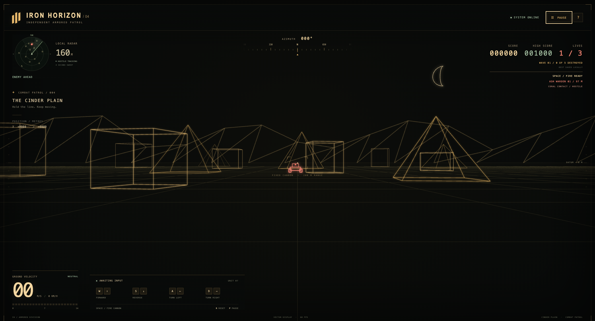

# Iron Horizon

An original first-person tank driving game on **the Cinder Plain**: solid amber wireframe structures, a ground grid, distant jagged mountains, and a crescent moon. The 3D renderer is handwritten JavaScript on a plain 2D canvas. No libraries, npm packages, network requests, or external assets.

## Preview



## Open the game

Open **`index.html`** directly in a modern browser with JavaScript enabled. It starts immediately; no server, installation, or build is required. All files must stay together.

From this directory, you can also open it with:

```sh
# macOS
open index.html

# Linux (desktop)
xdg-open index.html
```

On Windows, double-click `index.html` in File Explorer, or run `start index.html` in Command Prompt.

## Controls

| Key | Action |
| --- | --- |
| W / Up arrow | Drive forward (14 m/s) |
| S / Down arrow | Reverse (9 m/s) |
| A / Left arrow | Turn left |
| D / Right arrow | Turn right |
| R | Reset position and heading |
| Escape | Pause / resume |
| H / ? button | Driving guide / resume |

Hold drive and turn together to follow a curve. Release the keys to stop. Opposing directions cancel. Narrow screens have on-screen arrow buttons; hold them to drive or turn. Losing focus releases all held controls, and returning from a hidden tab does not cause a movement jump.

The compass shows heading clockwise from north (`+z`); the local scan rotates with the tank and displays structures within 160 metres. Position is in metres. The view follows window resizes and high-DPI displays.

**Milestone 2 of 4:** the 3D view, driving, horizon, and obstacle collisions. The jagged mountain ring and crescent moon move sideways as you turn, but never approach as you drive. All 20 cube/pyramid structures are solid: the tank stops at contact. Reverse or turn to find a clear route. The speedometer shows actual movement and the drive status reports **OBSTACLE CONTACT** when blocked. Shells, enemies, and scoring are not implemented yet.

Collision uses a 2 m tank radius and a ground circle enclosing each structure’s footprint (half its diagonal), including rotated corners. This leaves a small clearance around square bases. Movement is swept along the actual straight or curved path, so even a long frame cannot jump through a structure. Contact stops translation but does not prevent steering.

## Run the tests

Install **Node.js 18 or newer** (which includes npm). There are **no project dependencies to install**: do not run an install or build step.

From this directory:

```sh
node --version
npm test
```

The exact equivalent without npm is:

```sh
node --test
```

Tests use only `node:test`, `node:assert`, and other Node built-ins. They cover every worked example from milestones 1 and 2, the exact near-plane boundary, world geometry, script/CommonJS compatibility, and identical free drive-and-turn paths at 30, 60, and 144 frames per second. Collision tests include touching circles, forward/reverse stops, first impact across long frames and curved paths, tangent contact, escape, and every structure’s footprint. Horizon tests check the closed mountain ring, crescent outline, rotation, resizing, and identical sky projections after travelling far from the origin.

## Source layout

- `engine.js` — pure 3D maths, model/world geometry, clipping, sky projection, time-based movement, and swept circle collisions. No DOM, canvas, or keyboard code. Loads as a plain browser script or with `require('./engine.js')`.
- `main.js` — canvas drawing, input, pause/reset presentation, instruments, and the animation loop.
- `index.html` / `style.css` — local-file entry point and responsive cockpit UI.
- `engine.test.js` — built-in Node test suite.

World axes are `+x` right, `+y` up, `+z` forward; the ground is `y = 0`. Heading zero faces `+z`, and positive headings turn right. The engine clips lines at `z = 0.1` before perspective projection. `toCamera` preserves world `y`; the separate rendering pipeline subtracts the tank's 2.6 m eye height. It handles the distinction between clipping's inclusive boundary and `project`'s strict `z > 0.1` visibility rule.

`circlesHit(a, b)` includes touching circles. `moveTank(camera, controls, dt, obstacles = [])` returns a new camera and accepts the world’s `{ x, z, r }` obstacle circles; omitting them retains unobstructed driving. `projectSkyLine` ignores camera position and eye height, using heading only.

<!-- certo:models -->
*Generated with [Certo](https://github.com/alessioricco/certo), using `openai/gpt-6.1-sol`.*
<!-- /certo:models -->
